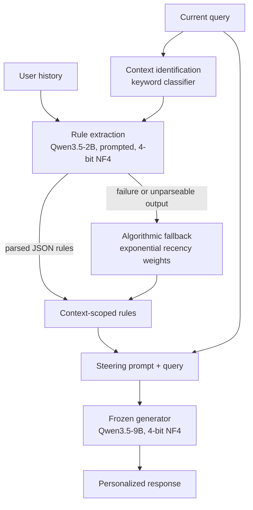

# CAPL: Context-Aware Preference Rules for Steering a Frozen LLM

[](LICENSE)

CAPL (Context-Aware Preference Learning) is research code for an exploratory pilot. A small model (Qwen3.5-2B) reads a user's interaction history and writes natural-language preference rules, each scoped to the context in which it applies. Those rules are placed in the prompt of a frozen generator (Qwen3.5-9B). No weights are updated, and both models run in 4-bit NF4 on a single NVIDIA L4 (24 GB). In a live pilot with ten synthetic users and 20 evaluation queries per method, CAPL reached 71.25% mean automated style-rule satisfaction, compared with 58.33% for a static profile, 56.67% for task-only rules and 48.75% for no personalization. **TF-IDF retrieval of past examples scored highest, at 88.33%.** These are descriptive results on synthetic data scored by deterministic style checks, not a claim of a general advantage.

The write-up: [CAPL: Context-Aware Preference Rules for Steering a Frozen LLM](https://palindromerice.github.io/writing/capl/).

## Why

Preference agents (Shashidhar et al., *Unsupervised Human Preference Learning*, EMNLP 2024) personalize a large model without fine-tuning it. A small model writes natural-language rules, and the frozen large model follows them. Personalization becomes an explicit text object that you can read, not a set of weights or a pile of retrieved examples.

A rule such as "keep answers concise" does not say *when* it applies. The same person may want a terse debugging answer with a short code sample and a detailed executive briefing with numbered recommendations. A single unscoped rule has to average those preferences or let one overwrite the other. CAPL tests whether attaching an explicit context condition, supporting evidence and a conflict flag to every rule helps. It differs from the original preference agents in two ways: rules come from prompting a small model, not training one, and applicability is a field of the rule.

## System design

The pipeline has three stages. Only the prompt changes between methods. The generator is the same in every case.



**Context identification.** A keyword classifier maps the query to a domain such as technical engineering, executive briefing or casual chat.

**Prompted rule extraction.** The small model receives the query, the detected context and the user's recent history (the last eight entries, each historical response truncated to 220 characters). It is asked to return applicable rules, note conflicting evidence and weight recent behavior more heavily. It samples at temperature 0.1. Each rule follows a structured schema:

```json
{
  "preference": "Use concise bullet points for technical debugging.",
  "target_aspect": "structure",
  "context_condition": "technical_engineering",
  "supporting_evidence_ids": ["interaction_07"],
  "conflict_detected": true
}
```

The context condition bounds the rule, the evidence identifiers trace it back to history, and the conflict flag records opposing patterns. The schema in code also carries a rule id, an uncalibrated confidence, optional conflict details and a recency weight.

**Algorithmic fallback.** If extraction fails or its output cannot be parsed, a deterministic path derives style features from history. It partitions interactions by context and weights them with exponential half-life recency decay. Recency is therefore handled two ways: by instruction in the model path and by explicit weighting in the fallback.

**Frozen generation.** Parsed rules are rendered as steering instructions and prepended to the query. The generator decodes greedily. Extraction results are cached per user, method and query.

**Hardware.** Both models load with 4-bit NF4 quantization (double quantization, bfloat16 compute) on one L4. Peak PyTorch allocation in the live pilot was about 7,503 MiB. The loader can unload the preference agent before loading the generator when memory is tight, and it can substitute a mock model so the whole pipeline runs on CPU without weights.

## Baselines

Five methods differ only in the personalization input that reaches the generator's prompt.

| ID | Method | Personalization input |
|---|---|---|
| B0 | No personalization | Current query only |
| B1 | Static profile | Globally applicable inferred rules |
| B2 | Retrieval | Up to three similar past interactions, ranked by TF-IDF cosine similarity over historical queries and context labels, under an approximate word budget |
| B3 | Task-only extraction | Rules inferred for the current task, without a context condition |
| B4 | CAPL | Rules scoped to the detected context |

## Evaluation design

**Synthetic personas.** Users are generated from templates with deliberately contrasting styles across contexts, plus configurable conflict and temporal drift. The intended preferences are known by construction. The live pilot used ten users, each with 20 historical interactions and two evaluation queries, giving 100 generations across the five methods.

**Deterministic style checks.** Each persona specifies checkable aspects: word-count limits, bullet or numbered formatting, required salutation phrases and the presence of code. A response's score is the fraction of applicable checks it passes. A method's score is the mean over its queries. No LLM judge or human rater is involved.

**Matched comparisons.** For every query, CAPL's score is compared with each other method's score on the same query and counted as higher, equal or lower. The code calls this a blinded pairwise judge. It randomizes presentation order but decides by the same deterministic scores. For rule-based methods (B1, B3, B4), the code also computes rule precision, recall and context accuracy against the synthetic ground truth.

## Results

Live pilot, 20 queries per method:

| Method | Mean rule satisfaction |
|---|---:|
| B0 No personalization | 48.75% |
| B1 Static profile | 58.33% |
| B2 TF-IDF retrieval | **88.33%** |
| B3 Task-only rules | 56.67% |
| B4 CAPL | 71.25% |

By context (ten technical queries and five executive and five casual queries per method):

| Context | Static profile | Retrieval | CAPL |
|---|---:|---:|---:|
| Technical engineering | 46.7% | 76.7% | 47.5% |
| Executive briefing | 80.0% | 100.0% | 90.0% |
| Casual chat | 60.0% | 100.0% | 100.0% |

Matched comparisons, CAPL against each method:

| CAPL compared with | Higher | Equal | Lower |
|---|---:|---:|---:|
| No personalization | 11 | 5 | 4 |
| Static profile | 8 | 8 | 4 |
| TF-IDF retrieval | 1 | 9 | 10 |
| Task-only rules | 9 | 7 | 4 |

Among the rule-based methods, the scoped one scores highest. Its gain over the static profile comes entirely from executive and casual queries. On technical queries it is no better than a static profile, and task-only rules (58.3%) score higher. Retrieval beats every rule-based method. Showing the generator past responses keeps exact salutations, lengths and formatting that a short extracted rule can drop. The open question is which preference information survives extraction.

## Repository map

| Path | Role |
|---|---|
| `src/data/` | Synthetic persona and history generator (`synthetic.py`), dataset preparation (`prepare.py`) |
| `src/preferences/` | Rule schema and extraction cache (`extractor.py`); context classifier, extraction prompts, JSON parsing and the B1, B3 and B4 extractors with their fallbacks (`contextual.py`) |
| `src/baselines/` | Static profile (B1) prompt formatting and TF-IDF retrieval (B2) |
| `src/generation/` | `PersonalizationPipeline`: builds the prompt for each method and calls the generator |
| `src/models/` | Quantized loader, model manager with optional sequential unloading, and the mock model |
| `src/evaluation/` | Deterministic satisfaction checks, matched comparison, inference metrics, confidence intervals (`metrics.py`); benchmark runner, CSV/JSON export and plots (`evaluate.py`) |
| `src/utils/` | Hardware detection and peak memory tracking |
| `scripts/` | Entry points: smoke test, B0 to B4 benchmark, ablation sweeps |
| `configs/experiment.yaml` | Model ids and fallbacks, quantization and decoding settings, dataset and ablation parameters |
| `tests/` | Unit tests |
| `results/` | Summaries, per-sample records and plots from mock-mode runs |

## Orientation for agents

Start with the three scripts in `scripts/`. `smoke_test.py` runs the full pipeline on two users with the mock model. `run_baselines.py` runs B0 to B4 and writes `summary.json`, `raw_eval_records.csv` and a comparison plot. It defaults to mock mode, and a live flag loads the quantized models on a GPU. `run_experiments.py` sweeps history length, rule limit, token budget and drift rate, and it also runs mock by default. From there, follow `src/generation/generator.py`, which dispatches on the baseline id, to the extractors in `src/preferences/contextual.py` and to `src/evaluation/evaluate.py`, which loops over users, samples and methods.

Settings live in `configs/experiment.yaml`. Some of its defaults (50 users, four test queries per user, four contexts) describe the synthetic generator's capacity, not the live pilot, which used ten users and two queries each.

Every file under `results/` (`smoke_test/`, `baselines/` and `ablations/`) comes from mock-mode runs. The mock model returns templated text, so latency and memory read as zero. Those numbers check that the pipeline works end to end. They are not findings, and they do not match the live pilot. For example, retrieval scores lowest in the mock baselines and highest live. The live pilot numbers in this README come from the write-up. The live per-generation records are not in this repository.

The tests cover the rule schema and its validation, the extraction cache, the B1, B3 and B4 extractors (algorithmic and model-driven via the mock), tolerant JSON parsing of model output, token budget handling in steering prompts, the static and retrieval baselines, synthetic data generation and serialization, the deterministic checks, the matched comparison, inference metrics, confidence intervals and mock model loading and unloading. None of them load real weights.


## Limitations

- **Synthetic users and automated scoring.** The results measure compliance with deterministic style checks on template personas. They do not establish human preference, factual correctness or usefulness.
- **Small sample.** There were 20 queries per method, with five or ten per context. The means are descriptive, and no significance test is reported.
- **Overlapping queries.** Histories and evaluation queries share a small template pool, so the pilot does not test generalization to unseen topics.
- **No live ablations.** The separate effects of context scoping and recency were not isolated on real models. The ablation sweeps in `results/` are mock-mode only.
- **Cost figures are partial.** Token counts are word-based estimates for the generator only and exclude preference-agent tokens.

## License

Code and results are released under the [Apache License 2.0](LICENSE). See [NOTICE](NOTICE).

## Citation

```bibtex
@misc{chawla2026capl,
  author       = {Naman Chawla},
  title        = {CAPL: Context-Aware Preference Rules for Steering a Frozen LLM},
  year         = {2026},
  howpublished = {\url{https://palindromerice.github.io/writing/capl/}}
}
```

Machine-readable citation metadata is in [CITATION.cff](CITATION.cff).
