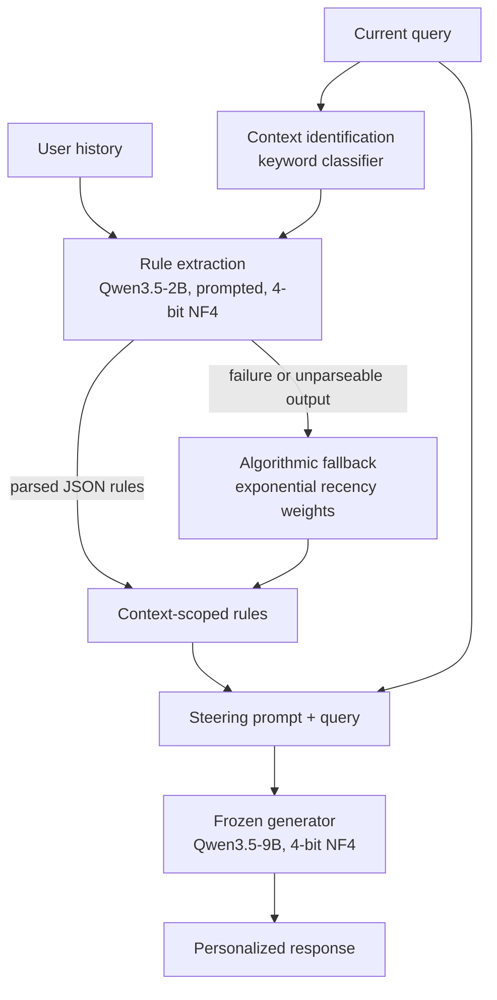

# CAPL: Context-Aware Preference Rules for Steering a Frozen LLM

[](LICENSE)

CAPL (Context-Aware Preference Learning) is research code for an exploratory pilot. A small model (Qwen3.5-2B) reads a user's history and writes natural-language preference rules, each scoped to the context where it applies, and those rules steer a frozen generator (Qwen3.5-9B) through its prompt. In a live pilot with ten synthetic users, CAPL reached 71.25% mean style-rule satisfaction versus 58.33% for a static profile and 48.75% for no personalization, while TF-IDF retrieval of past examples scored highest at 88.33%. Article: [CAPL: Context-Aware Preference Rules for Steering a Frozen LLM](https://palindromerice.github.io/writing/capl/) on palindromerice.github.io.

## Why

Preference agents (Shashidhar et al., EMNLP 2024) personalize a frozen model with readable rules written by a small model. But a rule like "keep answers concise" does not say *when* it applies, and the same person may want terse debugging answers and detailed executive briefings. CAPL attaches a context condition, supporting evidence and a conflict flag to every rule, and obtains rules by prompting rather than training.

## How it works

Only the prompt changes between methods; the generator is the same in every case.



**Context identification.** A keyword classifier maps the query to a domain such as technical engineering, executive briefing or casual chat.

**Prompted rule extraction.** The small model sees the query, the detected context and the last eight history entries, and returns rules that note conflicts and favor recent behavior:

```json
{
  "preference": "Use concise bullet points for technical debugging.",
  "target_aspect": "structure",
  "context_condition": "technical_engineering",
  "supporting_evidence_ids": ["interaction_07"],
  "conflict_detected": true
}
```

**Fallback.** If extraction fails or cannot be parsed, a deterministic path derives style features from history, partitioned by context and weighted by exponential recency decay.

**Frozen generation.** Rules are rendered as steering instructions ahead of the query; the generator decodes greedily.

**Hardware.** Both models run in 4-bit NF4 on one NVIDIA L4 (24 GB), peaking at about 7,503 MiB in the live pilot. A mock model lets the pipeline run on CPU without weights.

## Baselines

| ID | Method | Personalization input |
|---|---|---|
| B0 | No personalization | Current query only |
| B1 | Static profile | Globally applicable inferred rules |
| B2 | Retrieval | Up to three similar past interactions, ranked by TF-IDF |
| B3 | Task-only extraction | Rules for the current task, without a context condition |
| B4 | CAPL | Rules scoped to the detected context |

## Evaluation

Synthetic personas have deliberately contrasting styles across contexts, so intended preferences are known by construction. The live pilot used ten users with two evaluation queries each (20 per method). Scores are the fraction of deterministic style checks passed (word limits, bullet or numbered formatting, salutations, presence of code); no LLM judge or human rater is involved.

## Results

| Method | Mean rule satisfaction |
|---|---:|
| B0 No personalization | 48.75% |
| B1 Static profile | 58.33% |
| B2 TF-IDF retrieval | **88.33%** |
| B3 Task-only rules | 56.67% |
| B4 CAPL | 71.25% |

| Context | Static profile | Retrieval | CAPL |
|---|---:|---:|---:|
| Technical engineering | 46.7% | 76.7% | 47.5% |
| Executive briefing | 80.0% | 100.0% | 90.0% |
| Casual chat | 60.0% | 100.0% | 100.0% |

CAPL's gain over the static profile comes from executive and casual queries; retrieval beats every rule-based method, likely because past responses preserve details a short rule drops.

Everything under `results/` comes from mock-mode runs and is not a finding; the live numbers above come from the write-up.

## Limitations

- **Synthetic users and automated scoring.** Results measure compliance with style checks, not human preference or usefulness.
- **Small sample.** 20 queries per method; means are descriptive, with no significance test.
- **Overlapping queries.** Histories and evaluation queries share a small template pool, so generalization is untested.
- **No live ablations.** The separate effects of context scoping and recency were not isolated on real models.

## License

Code and results are released under the [Apache License 2.0](LICENSE). See [NOTICE](NOTICE).

## Citation

```bibtex
@misc{chawla2026capl,
  author       = {Naman Chawla},
  title        = {CAPL: Context-Aware Preference Rules for Steering a Frozen LLM},
  year         = {2026},
  howpublished = {\url{https://palindromerice.github.io/writing/capl/}}
}
```

Machine-readable citation metadata is in [CITATION.cff](CITATION.cff).
